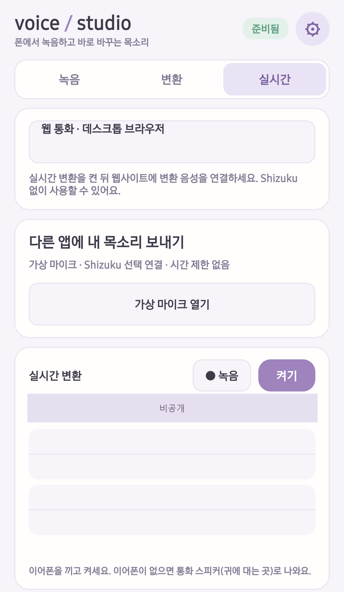
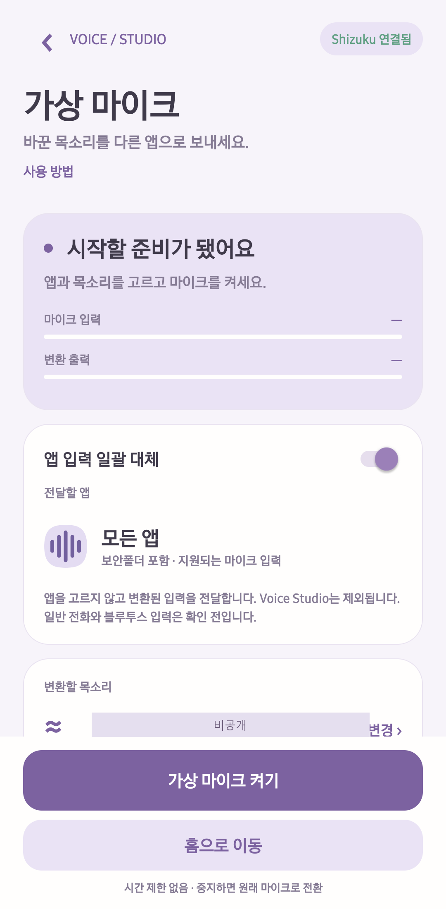
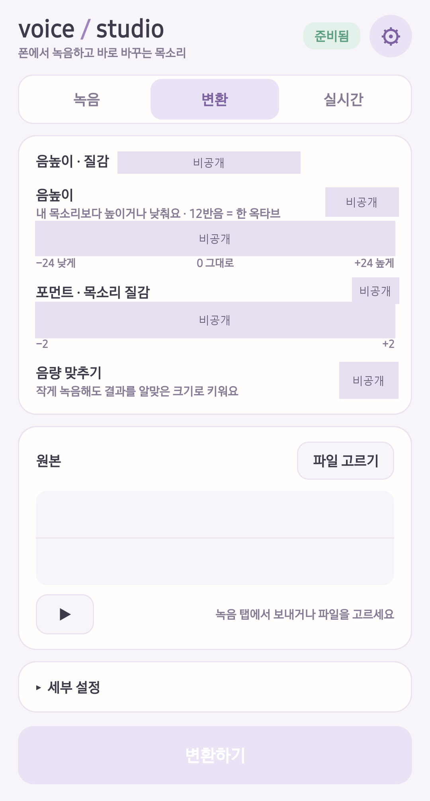
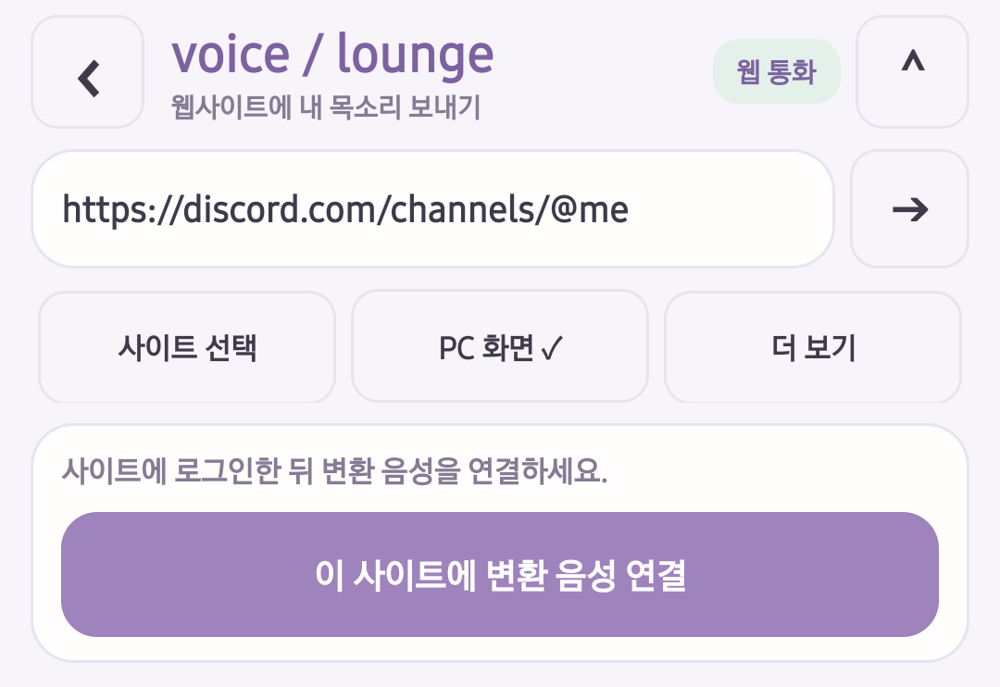

# RVC Voice Studio Mobile (Android)

[RVC](https://github.com/RVC-Project/Retrieval-based-Voice-Conversion-WebUI)(Retrieval-based Voice Conversion)를 바탕으로 만든 비공식 Android 목소리 변환 앱이에요. 변환 계산은 폰 안에서 하고, 녹음과 목소리 모델을 자동 업로드하지 않아요. 웹 통화에 연결하면 변환된 음성이 선택한 웹사이트로 전달돼요.

[English README](README.md)

**루팅은 필요 없습니다.** 다른 설치 앱의 마이크 입력을 바꾸려면 **Shizuku를 설치하고 실행한 뒤 Voice Studio를 승인**해야 합니다. **폰을 재부팅할 때마다, 또는 Shizuku 서비스가 종료될 때마다 다시 시작**해 주세요. 이미 실행 중이면 통화할 때마다 Shizuku를 재시작할 필요는 없습니다. 이후 사용할 때 Voice Studio의 **가상 마이크 켜기**를 누릅니다. [설정 안내](docs/USAGE.ko.md#shizuku로-가상-마이크-사용)

녹음·파일 변환·실시간 미리듣기·앱 안의 웹 통화에는 Shizuku가 **필요하지 않습니다.**

## 화면 미리보기

Galaxy S23+에서 캡처한 한국어 화면입니다. 개인 모델명과 변환 설정은 슬라이더 위치까지 불투명하게 가렸으며, 시스템 상태 표시줄과 웹사이트 내용은 제외했습니다. 앱은 영어도 지원합니다.

<table>
  <tr>
    <th>실시간 변환</th>
    <th>Shizuku 가상 마이크</th>
    <th>파일 변환</th>
  </tr>
  <tr>
    <td></td>
    <td></td>
    <td></td>
  </tr>
</table>

**웹 통화 조작부** — 사이트 선택, PC 화면 전환, 변환 음성 연결을 보여줍니다. 개인정보 보호를 위해 웹사이트 본문은 제외했으며, 실제 웹 통화 성공을 나타내는 화면은 아닙니다.

## 하나의 앱, 두 가지 음성 전달 방식

앱은 **한국어와 영어**를 지원합니다. Shizuku 없이 웹 통화를 사용하거나, Shizuku를 연결해 설치된 앱에 보내는 실험적 가상 마이크를 사용할 수 있습니다. Shizuku는 선택 기능이며 녹음·파일 변환·실시간 미리듣기에는 필요하지 않습니다.

- [앱 준비·웹 통화·Shizuku 사용법](docs/USAGE.ko.md)
- [PC 컨버터: 단계별 사용·USB/무선 전송·문제 해결](converter/USAGE.ko.md)
- 가상 마이크의 30초 시작 대기와 5분 실행 제한을 제거했습니다. 상태 알림에 현재 상태·경과 시간·끄기 버튼을 표시하고, 입력이 없으면 캡처와 변환 계산을 쉽니다.
- 경로와 청취 확인: Galaxy S23+ / Android 16의 네이티브 Discord·보안폴더 카카오톡. 다른 기기·일반 전화·블루투스 입력·Instagram 청취는 확인 전입니다. 짧은 화면 꺼짐 검사는 통과했으며 배터리 단독 장시간 사용은 확인 전입니다.

## 할 수 있는 것

- **녹음**: 파형을 보면서 녹음하고, 다시 듣고, 원하는 곳으로 넘기고, 여러 개를 보관해요.
- **변환**: 녹음이나 오디오 파일을 내 RVC 목소리 모델로 바꿔요. 음높이, 포먼트, 음역 보호, 억양 넓히기를 조절할 수 있어요.
- **실시간**: 마이크 소리를 바로 바꿔서 이어폰으로 들려줘요. 원래 목소리와 바뀐 목소리를 같이 녹음할 수도 있고, 화면을 꺼도 계속 돌아요.
- **계산 장치 자동 선택**: 스냅드래곤에서는 NPU를 우선 시도하고, 다른 기기는 CPU와 Vulkan GPU를 사용해요. NPU 디코더는 변환 도구에서 만든 가중치 8비트·중간값 16비트 정수 모델을 우선 사용해요. 가속기 초기화나 추론이 실패하면 해당 단계는 원본 FP32 모델을 CPU에서 실행해요. 실제 사용 장치와 전환 여부를 화면에 표시해요.
- **설정**(톱니바퀴): 목소리 모델, 계산 장치(추천 / 전부 32비트 / 직접 고르기), 진단 기록.

Galaxy S23+(스냅드래곤 8 Gen 2) 기준: 15초 녹음을 약 7초에 바꾸고, 실시간은 0.25초 블록을 한 번에 약 0.23초에 처리해요. 입에서 귀까지는 약 0.65초로 추정돼요.

## 웹 통화 시안 (통화 실측은 미완료)

`실시간 → 웹 통화 · 데스크톱 브라우저`에서 실시간 변환을 유지한 채 웹사이트를 탐색해요. 기본은 PC 화면이며 주소 입력, 뒤로·앞으로, 새로고침, 모바일 화면 전환과 로그인 정보 삭제를 지원해요. Discord·Meet·Instagram·Messenger 바로가기는 시작 주소이며, 해당 서비스의 통화 호환성을 보장하지 않아요.

1. 목소리 모델을 고르고 실시간 변환을 켜세요. 원음 비교 모드는 꺼야 해요.
2. 웹 화면을 열고 사이트에 로그인하세요. 필요하면 웹페이지의 **통화 오디오 준비**를 누르세요.
3. **이 사이트에 변환 음성 연결**을 누르고 사이트의 음성 통화에 참여하세요. 마이크 선택 목록에는 `Voice Studio · converted voice`가 표시돼요.

HuBERT + RMVPE + 인코더 / 디코더 구조는 그대로이며, 이어 붙인 변환 출력(48 kHz)을 웹 오디오 입력으로 전달해요. 웹 연결 중에는 내 목소리의 로컬 재생을 끄고, 연결을 해제하면 복원해요. 상대방 소리가 마이크에 들어가지 않도록 이어폰을 권장해요. 표시되는 웹 대기 시간은 전체 통화 지연이 아니에요.

원본 마이크와 카메라에 대한 웹 권한은 거부해요. 페이지의 입력 교체가 실패해도 원음으로 전환하지 않아요. 변환 중단, 페이지 이동·새로고침, 앱 전환·화면 잠금 때 음성 연결을 해제하고 대기 음성을 지워요. 돌아오면 다시 연결해야 해요. 기존 실시간 변환 자체는 계속 실행될 수 있어요. 웹 입력이 연결되기 전과 해제된 뒤에는 합성 입력이 무음이에요.

현재 시안은 화면을 켠 상태의 최상위 HTTPS 페이지에서 **음성 통화만** 지원해요. iframe 안의 통화, 카메라·화면 공유, WebView 로그인을 막는 서비스는 지원하지 않을 수 있어요. Android System WebView가 문서 시작 스크립트와 웹 메시지 기능을 지원해야 음성을 연결할 수 있고, 미지원이면 탐색만 가능해요.

2026-10-11 S23+ / Android System WebView 154.0.8037.106에서 데스크톱 로그인 화면, 실시간 변환과 웹뷰 동시 실행, 변환 PCM의 웹 오디오 버퍼 진입, 연결 해제·새로고침 시 전달 해제를 확인했어요. 로그인과 실제 상대방 수신, 통화 지연·장시간 안정성은 아직 검증하지 않았어요. 표시된 웹 대기 100ms는 한 시점의 버퍼 값이며 전체 통화 지연이 아니에요. 통화 참여·마이크 재선택, 연결 해제·변환 중단·페이지 이동 시 상대방에게 무음이 전달되는지, 다시 연결, 이어폰 수신과 장시간 부하를 확인해야 해요. 로컬 검사는 `node --test android/web-tests/bridge.test.cjs`와 Gradle `:app:testDebugUnitTest`로 실행해요.

## 폰에서 어떻게 돌아가나 (측정)

RVC는 모델 네 개로 말소리를 다른 목소리로 바꿔요. 각 모델을 빠르면서도 정밀도가 충분한 곳에서 돌려요.

| 부분 | 하는 일 | 돌리는 곳 (추천) | 숫자 형식 | 실시간 한 단계 |
| --- | --- | --- | --- | --- |
| HuBERT (ContentVec) | 무슨 말인지 | NPU | 16비트 소수 | 61 ms |
| RMVPE | 음높이 | NPU (안의 GRU만 CPU) | 16비트 소수 | 12~15 ms |
| enc | 목소리 특징 | NPU | 16비트 소수 | 11 ms |
| 디코더 (NSF-HiFiGAN, 48 kHz) | 파형 만들기 | NPU | 가중치 8비트, 중간값 16비트 정수 (W8A16) | 약 105 ms |
| 리샘플, SOLA 크로스페이드, 잡음 | 이어 붙이기 | CPU (Kotlin) | 32비트 소수 | 약 25 ms |

조건: Galaxy S23+ (스냅드래곤 8 Gen 2: Hexagon NPU v73, Adreno 740 GPU), Android 16, ONNX Runtime 1.22.0 + QNN 2.33.0, ncnn (Vulkan), 릴리스 빌드, 식은 상태에서 시작. 실시간 수치는 15초 말소리 녹음을 블록 속도로 흘려 넣어서 잰 계산 시간이에요(오디오 장치 제외). 앞 모델들의 창은 1.6초예요.

### 디코더를 정수로 돌리는 이유

디코더는 파형을 직접 만들어서, 반올림 오차가 그대로 소리에 들어가요. PC에서 디코더를 마지막 업샘플 단계 전까지 16비트 소수(합은 32비트)로 돌리면 평균 스펙트럼이 0.07~0.17 dB만 바뀌었지만, 마지막 단계 하나만으로 0.6~0.8 dB, 출력층 하나만으로 3.4 dB가 바뀌었어요. 손상은 목소리가 조용한 곳의 잡음 바닥으로 나타나요.

같은 디코더 입력을 S23+에서 돌려 PC의 32비트 출력과 비교했어요.

| 디코더 | 2초 분량 | 실시간 한 단계 (50프레임) | 파형 SNR |
| --- | --- | --- | --- |
| GPU, 32비트 소수 (ncnn Vulkan) | 1000 ms | 330 ms | 기준 |
| NPU, 16비트 소수 | 431 ms | 86 ms | 8.1~11.0 dB |
| **NPU, W8A16** | **473 ms** | **104 ms** | **23.9~30.8 dB** |
| NPU, W16A16 | 거부됨: 이 NPU(v73)는 ConvTranspose의 16비트 가중치를 못 받아요 | | |
| NPU, W16A16 (ConvTranspose만 8비트) | 663 ms | | 7.0~10.0 dB (PC CPU에서는 25.6~38.3 dB) |

PC GPU(CUDA)의 16비트 소수는 47~60 dB를 유지해요. 그래서 NPU의 16비트 소수 모드는 16비트 반올림만으로는 설명이 안 될 만큼 많이 잃어요.

합성기는 잡음을 뽑아 쓰니 결국 들리는 게 중요해요. 실시간에서 같은 입력·같은 난수 시드로 32비트 GPU 디코더와 비교했어요.

| | 평균 스펙트럼 | 프레임별 mel | 기본음 아래(~100 Hz) 잡음 바닥 |
| --- | --- | --- | --- |
| 32비트끼리, 난수 시드만 다름 | 0.12 dB | 1.65 dB | |
| NPU, 16비트 소수 | 1.21 dB | 2.02 dB | +8.3 dB |
| **NPU, W8A16** | **0.14 dB** | **0.51 dB** | **+3.1 dB** |

배음 자체는 16비트 소수 디코더에서도 0.3 dB 안이에요. 대신 배음 아래와 사이를 잡음으로 채워서 목소리가 거칠게 들려요. W8A16은 32비트와의 차이가 난수 시드 두 개 사이의 차이와 비슷해요. 변환 도구가 목소리마다 내 녹음 몇 분(0, +6, +12반음으로 옮겨서)으로 보정해요: 디코더에 실제로 들어가는 값의 MinMax 범위, 채널별 대칭 8비트 가중치, 16비트 중간값. 남은 오차는 대부분 8비트 가중치에서 와요.

### 속도

파일 변환, 15초 말소리:

| 앞 단계 (HuBERT, RMVPE, enc) | 디코더 | 걸린 시간 |
| --- | --- | --- |
| CPU | CPU, 32비트 | 18.4초 |
| CPU | GPU, 32비트 (전부 32비트) | 13.1초 |
| NPU | NPU, 16비트 소수 | 6.0초 |
| NPU | NPU, W8A16 (추천) | 6.9초 |

실시간, 블록마다 한 단계 (한 단계가 블록 길이 안에 끝나야 해요):

| 앞 단계 / 디코더 | 블록 | 한 단계, 평균 / 95% | 부하 |
| --- | --- | --- | --- |
| CPU / GPU 32비트 | 0.2초 | 568 / 593 ms | 284% |
| NPU / GPU 32비트 | 0.2초 | 440 / 470 ms | 220% |
| NPU / NPU 16비트 소수 | 0.2초 | 198 / 209 ms | 99% |
| NPU / NPU 16비트 소수 | 0.25초 | 223 / 236 ms | 89% |
| NPU / NPU W8A16 | 0.2초 | 212 ms | 106% |
| **NPU / NPU W8A16 (기본)** | **0.25초** | **229 ms** | **92%, 끊김 없음** |

### 그 밖에 알아낸 것

- **QNN은 NPU에서 Erf를 못 돌려요.** HuBERT의 GELU 20개(erf 수식으로 내보내짐)가 CPU로 빠지면서 모델이 NPU 조각 21개로 잘렸어요(한 단계 131~154 ms). 변환 도구가 각각을 Gelu 노드 하나로 합치면(`converter/htp_export.py`) 모델 전체가 NPU에서 61 ms에 돌아요. CPU에서 돌린 결과는 비트 단위로 같아요.
- **GPU 디코더는 정확하지만 부르는 비용이 커요.** ncnn Vulkan은 호출마다 약 140 ms에 프레임당 4.3 ms가 더 들어요. 파일 변환엔 괜찮고 실시간엔 느려요.
- **실시간 디코더의 왼쪽 문맥은 10프레임(0.1초)이면 돼요.** 전체를 한 번에 디코딩한 것과 126 dB로 맞아요(8프레임 62 dB, 6프레임 35 dB).
- **속도는 릴리스 빌드로 재야 해요.** Kotlin 신호 처리가 디버그 빌드에서는 한 단계 약 250 ms, 릴리스 빌드에서는 약 35 ms였어요(지금은 약 25 ms).
- **발열.** 실시간 60초에 칩 온도가 39 → 47 °C로 올라요. 40분 쓰면 열 상태 3까지 가는데, NPU 쪽 시간은 그대로이고 CPU 쪽이 40 → 73 ms로 늘어서 끊김이 모두 약 53초 생겼어요.
- **오디오.** S23+는 가공 없는 마이크 소스(UNPROCESSED)를 주지 않아서 VOICE_RECOGNITION으로 녹음해요. 출력 버퍼를 권장값 100 ms 대신 20 ms로 잡아서 지연을 80 ms 줄였어요.

## 필요한 것

- Android 10 이상, arm64 폰.
- 파일·실시간 변환 모두 CPU/GPU 경로를 사용할 수 있어요. `설정 → 계산 장치` 선택은 두 모드에 적용돼요. GPU 모델이나 Vulkan이 없으면 CPU를 사용해요.
- 실시간 속도는 칩셋·메모리·발열에 따라 달라요. 처리 속도가 블록 길이를 넘으면 앱에서 안내해요. 블록을 늘리거나 파일 변환을 이용할 수 있어요.
- 기기 실측은 Galaxy S23+에서만 했어요. 다른 칩셋 지원을 위한 자동 선택·오류 복구는 추가했지만, Exynos·MediaTek·Tensor 등의 실기기 검증은 아직 하지 않았어요. Android/ARM64 조건만으로 모든 기기의 동작을 보장하지는 않아요.
- 변환 도구용 Windows PC (파이썬 3.10 이상, 나머지는 도구가 알아서 설치해요).

## 시작하기

1. Releases의 APK를 설치해요 (또는 아래처럼 직접 빌드).
2. 공통 모델(HuBERT, RMVPE, NPU용 HuBERT, 약 1.1 GB)을 받아요: 앱의 설정에서 **받기**. 받기가 안 되면 변환 도구의 `--common`으로 만들어서 옮겨요.
3. 목소리 모델을 PC에서 [`converter/`](converter/README.md)로 바꿔요: `rvc2phone_gui.bat`을 열고 RVC v2 48 kHz `.pth`를 추가, NPU 디코더용으로 내 녹음(WAV) 몇 분을 `converter/calib`에 넣고 **변환하기**. USB나 무선 디버깅이 켜져 있으면 **폰으로 보내기**로 앱에 바로 들어가요. 아니면 출력 폴더나 zip을 앱 설정에서 불러와요.

목소리 모델은 들어 있지 않고, 앱이 따로 내려받지도 않아요. 쓸 권리가 있는 모델과 목소리만 쓰세요.

## 빌드

- **Android**: `cd android && ./gradlew assembleRelease` (JDK 17, Android SDK, NDK 28). 키스토어(`VS_KEYSTORE`, `VS_KEYSTORE_PASSWORD`)가 없으면 디버그 키로 서명돼요.
- **CI**: `.github/workflows/build.yml`이 올릴 때마다 테스트하고 APK를 빌드해요.
- **테스트**: `./gradlew testDebugUnitTest` (신호 처리를 기준 파이프라인의 값과 비교).

## 아직 안 되는 것

- RVC v2, 48 kHz, 음높이(f0) 있는 모델만 돼요.
- Android는 다른 앱의 마이크를 바꿔치기할 수 없어서, 실시간 소리는 이어폰(또는 통화 스피커)으로 나와요.
- 실시간은 CPU와 NPU를 계속 써서 오래 쓰면 폰이 뜨거워지고, CPU가 뜨거워지면 가끔 소리가 끊길 수 있어요.
- NPU 경로는 아직 폰 한 대에서만 확인했어요.
- iPhone 버전은 따로 나올 예정이에요.

## 라이선스

MIT. [LICENSE](LICENSE)와 [NOTICE.md](NOTICE.md)를 보세요.
