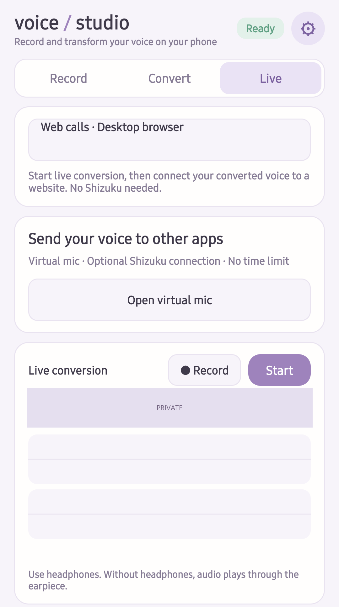
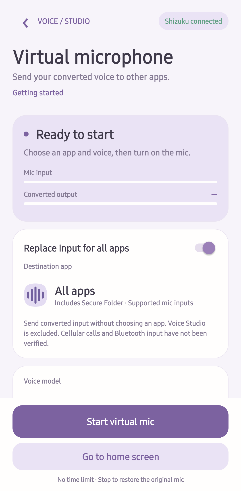
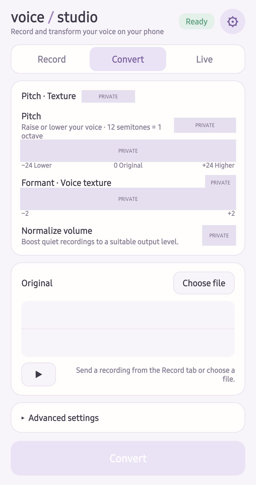
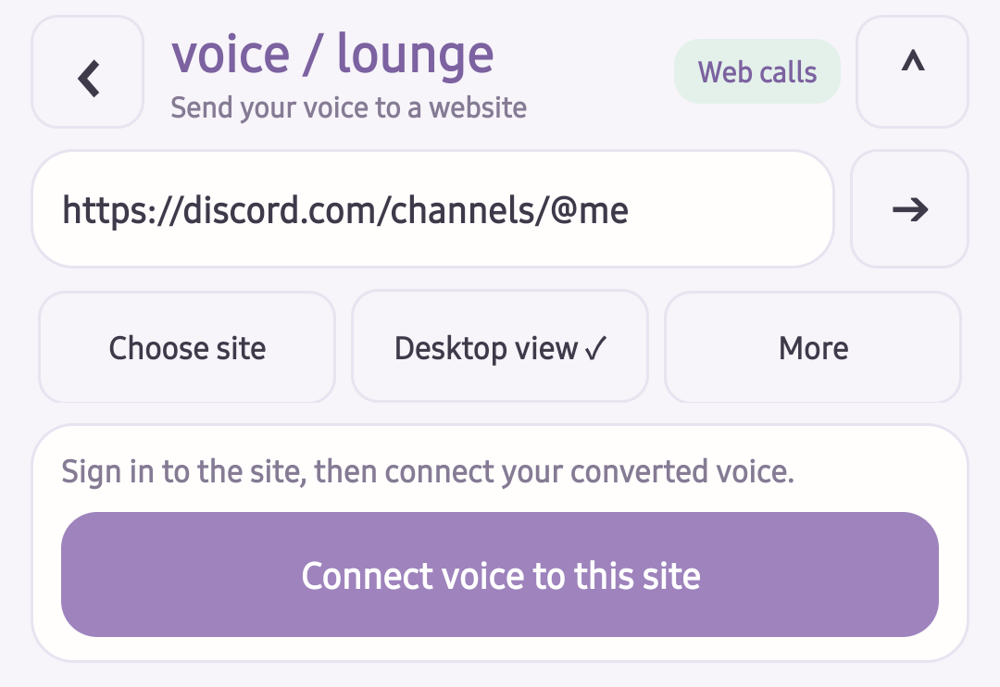

# RVC Voice Studio Mobile (Android)

Unofficial voice conversion for Android phones, based on [RVC](https://github.com/RVC-Project/Retrieval-based-Voice-Conversion-WebUI) (Retrieval-based Voice Conversion). Conversion runs on the phone; recordings and voice models are not automatically uploaded. Connecting a web call sends converted audio to the selected website.

[한국어 README](README.ko.md)

**No root required.** To replace microphone input in other installed apps, **Shizuku must be installed and running**, with Voice Studio authorized. Start Shizuku again after every phone reboot or whenever its service stops; you do not need to restart it for every call while it is still running. Then turn on **Virtual microphone** in Voice Studio for your session. [Setup guide](docs/USAGE.md#virtual-microphone-with-shizuku)

Recording, file conversion, local live monitoring and in-app web calls do **not** require Shizuku.

**New in 0.4.3:** optional automatic block length, saved per voice. Before starting, it measures processing time and increases the session block when needed, preserving additional context and the saved manual block. Enable it in Live settings or Virtual microphone → Voice and live settings. It starts off; more processing headroom may mean more delay.

**Also available since 0.4.2:** experimental cellular call conversion on Galaxy S23+ (SM-S916N), and realtime settings saved separately for each voice model. [Phone-call setup and supported routes](docs/USAGE.md#experimental-cellular-phone-calls)

## Screenshots

Captured on a Galaxy S23+ with the English UI. Personal model names and conversion settings are covered with opaque masks, including slider positions. System status bars and website content are omitted. See the [Korean README](README.ko.md) for Korean screenshots.

<table>
  <tr>
    <th>Live conversion</th>
    <th>Shizuku virtual microphone</th>
    <th>File conversion</th>
  </tr>
  <tr>
    <td></td>
    <td></td>
    <td></td>
  </tr>
</table>

**Web call controls** — site selection, desktop view and converted-voice connection. The website itself is excluded for privacy; this image is not a claim of a verified web call.

## One app, two ways to send your voice

The UI now supports **English and Korean**. Use web calls without Shizuku, or connect Shizuku to use the experimental virtual microphone with installed apps. Shizuku is optional; recording, file conversion and local live monitoring work without it.

- [App setup, web calls and Shizuku instructions](docs/USAGE.md)
- [PC converter: every step, USB/wireless transfer and troubleshooting](converter/USAGE.md)
- The virtual mic has no 30-second start deadline or five-minute limit. Its ongoing notification shows status and elapsed time and provides a Stop button. No active destination input means capture/inference pause.
- Tested routing/listening: Galaxy S23+ / Android 16, native Discord, Secure Folder KakaoTalk and the separate experimental cellular-call mode on SM-S916N using the earpiece. Other hardware, Bluetooth input and Instagram listening remain unverified. Short screen-off testing passed; long battery-only use is not yet validated.

## Web call prototype (end-to-end calls not yet validated)

Open **Live → Web calls · Desktop browser** to browse desktop sites while the existing realtime conversion continues. The browser includes an address bar, back/forward, reload, desktop/mobile display, and login-data clearing. Discord, Meet, Instagram and Messenger shortcuts are entry URLs, not a claim of verified call compatibility.

Start realtime conversion with a voice model and bypass disabled, open the website, sign in, tap **Prepare call audio** in the page if needed, then **Connect voice to this site** and join the site's audio call. The supplied microphone is named `Voice Studio · converted voice`.

The HuBERT + RMVPE + encoder / decoder pipeline is unchanged. Its joined 48 kHz output feeds a synthetic Web Audio microphone. Local voice monitoring is muted while connected and restored on disconnect. Use headphones to keep received audio out of the physical mic. Displayed web queue time is not total call latency.

Native web permissions for the physical microphone and camera are always denied; a failed bridge never falls back to raw capture. Conversion stopping, navigation/reload, leaving the browser or locking the screen disconnects forwarding and clears queued audio. Reconnect explicitly on return. Native realtime conversion may continue. The synthetic input is silent until connected and after disconnecting.

This prototype supports foreground **audio-only** calls on top-level HTTPS pages. Embedded calls, camera/screen sharing and services that reject WebView sign-in may not work. Audio forwarding requires Android System WebView support for document-start scripts and web messaging; unsupported providers can still browse.

On 2026-10-11, a Galaxy S23+ with Android System WebView 154.0.8037.106 displayed the desktop login page while realtime conversion ran, accepted converted PCM into its Web Audio buffer, and disconnected forwarding on explicit disconnect/reload. A displayed 100 ms queue was a single buffer observation, not end-to-end latency. Login, remote reception, call latency and sustained calling remain unverified. Device checks must cover joining/reacquiring the mic, remote silence after disconnect/stop/navigation, reconnection, headphone receive audio and sustained load. Local checks: `node --test android/web-tests/bridge.test.cjs` and Gradle `:app:testDebugUnitTest`.

## What it does

- **Record** with a live waveform, then play back, seek and keep takes.
- **Convert** a recording or an audio file with your own RVC voice model: pitch shift, formant, pitch range guards and intonation.
- **Realtime**: the microphone converted into your earphones, with an optional recording of both the original and the converted voice. It keeps running with the screen off.
- **Automatic compute selection**: Snapdragon devices try the NPU; other devices use CPU and Vulkan GPU paths. NPU decoding prefers the 8-bit-weight / 16-bit-activation model made by the converter. If accelerator initialization or inference fails, that stage retries on CPU with its original FP32 model. The UI shows the active devices and any fallback.
- **Settings** behind the gear: voice models, where the models run (Recommended / All 32-bit / Custom) and diagnosis logs.

On a Galaxy S23+ (Snapdragon 8 Gen 2), a 15 s recording converts in about 7 s, and realtime runs 0.25 s blocks in about 0.23 s each, with an estimated 0.65 s from mouth to ear.

Realtime output gain, block size, additional context, crossfade, output buffer and silence threshold are saved per voice model. Switching voices restores that model’s settings, shared between Live and the virtual microphone. Existing global settings are preserved as each model’s initial values.

## How it runs on the phone (measured)

RVC turns speech into another voice in four models. Each one runs where it is both fast enough and precise enough:

| Part | Job | Runs on (Recommended) | Numbers | Per realtime step |
| --- | --- | --- | --- | --- |
| HuBERT (ContentVec) | what is said | NPU | 16-bit float | 61 ms |
| RMVPE | pitch | NPU (its GRU on the CPU) | 16-bit float | 12-15 ms |
| enc | voice features | NPU | 16-bit float | 11 ms |
| Decoder (NSF-HiFiGAN, 48 kHz) | the waveform | NPU | 8-bit weights, 16-bit integer activations (W8A16) | about 105 ms |
| Resampling, SOLA crossfade, noise | the glue | CPU (Kotlin) | 32-bit float | about 25 ms |

Conditions: Galaxy S23+ (Snapdragon 8 Gen 2: Hexagon NPU v73, Adreno 740 GPU), Android 16, ONNX Runtime 1.22.0 with QNN 2.33.0, ncnn (Vulkan), release build, starting cool. The realtime numbers come from feeding a 15 s speech recording at block speed (computation only, no audio devices), with a 1.6 s window for the front models.

### Why the decoder runs in integers

The decoder writes the waveform itself, so its rounding errors land directly in the sound. On the PC, running it in 16-bit floats (with 32-bit sums) up to its last upsampling stage changed the average spectrum by only 0.07-0.17 dB, but the last stage alone by 0.6-0.8 dB and the output layer alone by 3.4 dB: the damage is a noise floor where the voice is quiet.

The same decoder input on the S23+, against the PC's 32-bit output:

| Decoder | 2 s of audio | Realtime step (50 frames) | Waveform SNR |
| --- | --- | --- | --- |
| GPU, 32-bit float (ncnn Vulkan) | 1000 ms | 330 ms | reference |
| NPU, 16-bit float | 431 ms | 86 ms | 8.1-11.0 dB |
| **NPU, W8A16** | **473 ms** | **104 ms** | **23.9-30.8 dB** |
| NPU, W16A16 | refused: this NPU (v73) does not take 16-bit ConvTranspose weights | | |
| NPU, W16A16 with 8-bit ConvTranspose | 663 ms | | 7.0-10.0 dB (25.6-38.3 dB on the PC's CPU) |

16-bit floats on a PC GPU (CUDA) keep 47-60 dB, so the NPU's 16-bit float mode loses far more than 16-bit rounding alone explains.

A synthesizer draws noise, so what matters is what you hear: in realtime, with the same input and random seed, against the 32-bit GPU decoder:

| | Average spectrum | Per-frame mel | Noise floor below the fundamental (~100 Hz) |
| --- | --- | --- | --- |
| Two 32-bit runs, only the random seed differs | 0.12 dB | 1.65 dB | |
| NPU, 16-bit float | 1.21 dB | 2.02 dB | +8.3 dB |
| **NPU, W8A16** | **0.14 dB** | **0.51 dB** | **+3.1 dB** |

The harmonics themselves stay within 0.3 dB even on the 16-bit float decoder; it fills the gaps below and between them with noise, which you hear as a rough voice. W8A16 is about as close to 32-bit as two random seeds are to each other. The converter calibrates it per voice on a few minutes of your own recordings (shifted by 0, +6 and +12 semitones): MinMax ranges of the decoder's real inputs, 8-bit per-channel symmetric weights, 16-bit activations. Most of the remaining error comes from the 8-bit weights.

### Speed

File conversion, 15 s of speech:

| Front (HuBERT, RMVPE, enc) | Decoder | Time |
| --- | --- | --- |
| CPU | CPU, 32-bit | 18.4 s |
| CPU | GPU, 32-bit (All 32-bit) | 13.1 s |
| NPU | NPU, 16-bit float | 6.0 s |
| NPU | NPU, W8A16 (Recommended) | 6.9 s |

Realtime, one step per block (a step must finish within its block):

| Front / decoder | Block | Step, average / 95th percentile | Load |
| --- | --- | --- | --- |
| CPU / GPU 32-bit | 0.2 s | 568 / 593 ms | 284% |
| NPU / GPU 32-bit | 0.2 s | 440 / 470 ms | 220% |
| NPU / NPU 16-bit float | 0.2 s | 198 / 209 ms | 99% |
| NPU / NPU 16-bit float | 0.25 s | 223 / 236 ms | 89% |
| NPU / NPU W8A16 | 0.2 s | 212 ms | 106% |
| **NPU / NPU W8A16 (default)** | **0.25 s** | **229 ms** | **92%, no dropouts** |

### Other findings

- **QNN has no Erf on the NPU.** HuBERT's 20 GELUs (exported as erf formulas) fell back to the CPU and cut the model into 21 NPU pieces: 131-154 ms a step. The converter fuses each one into a single Gelu node (`converter/htp_export.py`) and the whole model runs on the NPU in 61 ms, with bit-identical results on the CPU.
- **The GPU decoder is exact but slow to call.** ncnn on Vulkan costs about 140 ms per call plus 4.3 ms per frame: fine for files, too slow for realtime.
- **The realtime decoder needs only 10 frames (0.1 s) of left context.** It then matches a full decode at 126 dB (8 frames: 62 dB, 6 frames: 35 dB).
- **Measure release builds.** The Kotlin signal processing took about 250 ms a step in a debug build and about 35 ms in a release build (since cut to about 25 ms).
- **Heat.** 60 s of realtime warms the chip from 39 to 47 °C. Over 40 minutes the phone reached thermal status 3: the NPU parts kept their time while the CPU parts grew from 40 to 73 ms, adding up to about 53 s of dropouts.
- **Audio.** The S23+ does not offer the unprocessed microphone source, so the app records with VOICE_RECOGNITION. A 20 ms output buffer instead of the suggested 100 ms took 80 ms off the latency.

## Requirements

- Android 10 or later on an arm64 phone.
- Both file and realtime conversion can use CPU/GPU paths. Settings → compute device applies to both modes. Without Vulkan or the GPU model files, decoding uses CPU.
- Realtime throughput depends on chipset, available memory and thermals. The app warns when processing exceeds the block duration; increase the block size or use file conversion.
- Device measurements are from the Galaxy S23+ only. Automatic selection and fallback have been added for broader compatibility, but Exynos, MediaTek, Tensor and other devices have not been validated. Android/ARM64 requirements alone do not guarantee operation on every device.
- A Windows PC for the converter (Python 3.10 or later; it sets up its own environment).

## Getting started

1. Install the APK from the Releases page (or build it, see below).
2. Get the shared models (HuBERT, RMVPE and HuBERT for the NPU, about 1.1 GB): tap **받기** (download) in the app's settings. If the download does not work, build them with the converter (`--common`) and copy them over.
3. Follow the [illustrated converter walkthrough](converter/USAGE.md): open `rvc2phone_gui.bat`, choose English or Korean, and add an RVC v2 32/48 kHz `.pth`. For the NPU decoder, select **Snapdragon · CPU + GPU + NPU** under **Prepare** and choose a few minutes of calibration WAVs. Click **Start conversion**, then select completed results under **Send to phone** for USB/wireless transfer. Without debugging, import the output folder or ZIP in the app.

Voice models are not included and are never downloaded by the app. Use only models and voices you have the right to use.

## Building

- **Android**: `cd android && ./gradlew assembleRelease` (JDK 17, Android SDK, NDK 28). Without a keystore (`VS_KEYSTORE`, `VS_KEYSTORE_PASSWORD`) the release APK is signed with the debug key.
- **CI**: `.github/workflows/build.yml` tests and builds the APK on every push.
- **Tests**: `./gradlew testDebugUnitTest` (the signal processing against golden vectors from the reference pipeline).

## Limitations

- Android supports RVC v2 models at 32 or 48 kHz with pitch (f0). 32 kHz requires app 0.4.1 or later and the complete model folder, including `model.json`. iOS remains 48 kHz only.
- Android does not let one app replace another app's microphone, so realtime output goes to your earphones (or the earpiece).
- Realtime keeps the CPU and NPU busy: phones get warm in long sessions, and a hot CPU can make the voice drop out now and then.
- The NPU path is tested on one phone so far.
- An iPhone version exists and will follow separately.

## License

MIT, see [LICENSE](LICENSE) and [NOTICE.md](NOTICE.md).
