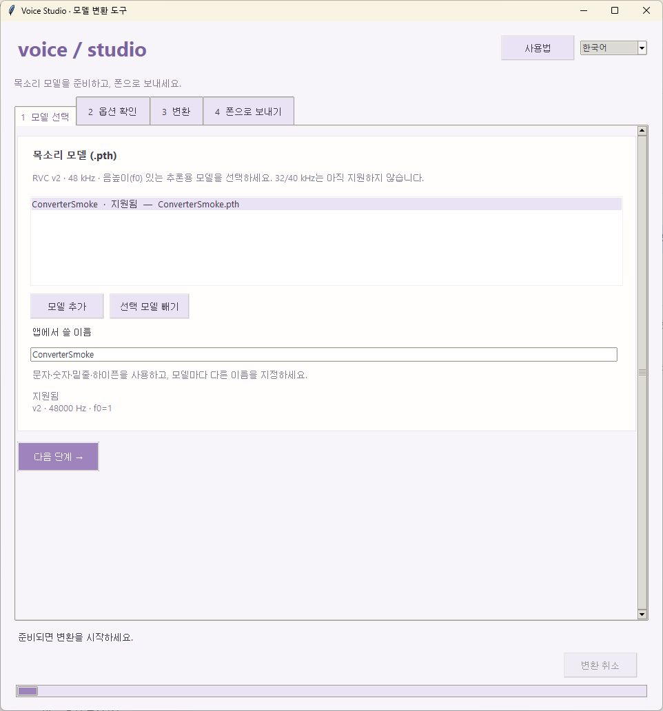
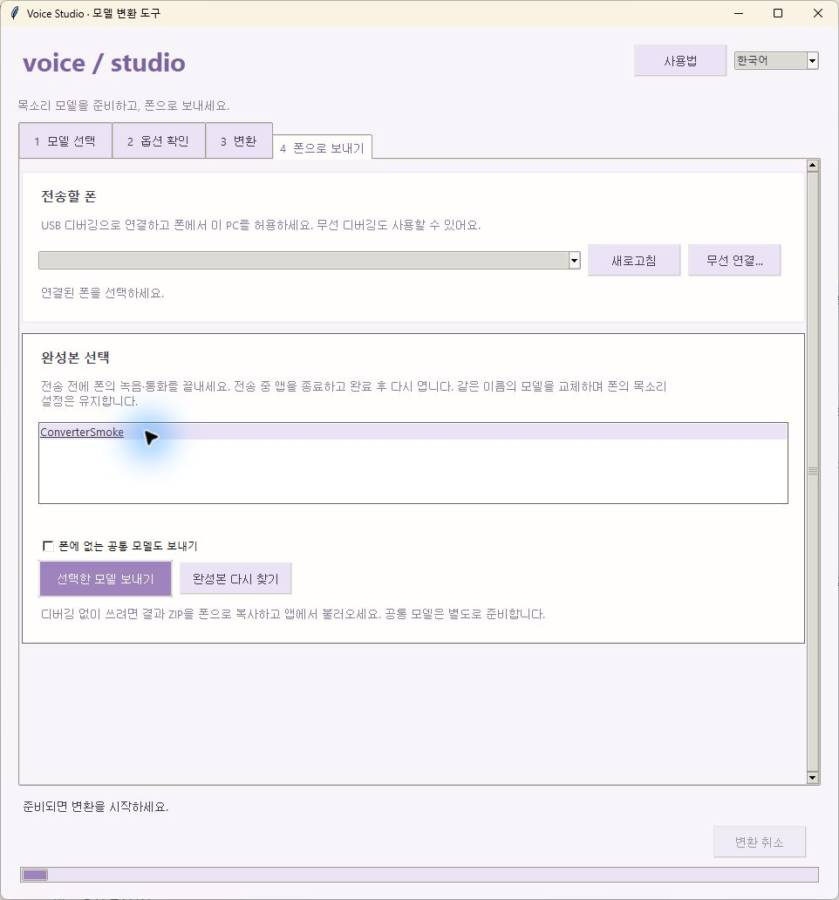

# rvc2phone: RVC 목소리 모델을 폰 앱용으로 바꾸기

**Step-by-step:** [English walkthrough](USAGE.md) · [한국어 단계별 안내](USAGE.ko.md)


Voice Studio 폰 앱(Android, iPhone)은 RVC 목소리 모델을 ONNX 파일로 나눠서 써요. 이 도구가 `.pth` 모델을 그 파일들로 바꿔 줘요.

## 창으로 쓰기 (Windows, 권장)

`rvc2phone_gui.bat`을 두 번 누르세요 (목소리 모델 `.pth`를 이 파일 위에 끌어다 놓으면 그 모델이 담긴 채로 열려요).
처음 한 번은 필요한 패키지를 설치하느라 몇 분 걸려요 (약 1 GB).

상단에서 한국어 / English를 전환할 수 있어요.

1. **모델 선택**: 여러 `.pth`의 v2 · 32/48 kHz · f0 지원 여부를 검사하고 이름을 정해요.
2. **옵션 확인**: 일반 Android(CPU + GPU), Snapdragon(NPU 포함), CPU만 중 선택해요. 연결된 폰으로 추천받고 보정 WAV와 출력 폴더를 확인해요. 공통 모델은 완성된 파일이 있으면 재사용해요.
3. **변환**: 단계와 경과 시간, 기록을 확인해요. 취소하거나 실패한 작업만 재시도할 수 있어요. 새 출력과 ZIP 검증이 끝나야 기존 결과를 교체해요.
4. **폰으로 보내기**: USB / 무선 디버깅으로 연결하고 보낼 완성본을 직접 골라요. 이전 변환 결과도 불러올 수 있어요. 폰의 기존 목소리 설정은 유지하며 전송 후 앱을 다시 열어요.

자세한 순서와 문제 해결은 [한국어 사용법](USAGE.ko.md) / [English walkthrough](USAGE.md)를 참고하세요.

<details>
<summary>컨버터 화면 보기 · 예시 모델과 경로 사용</summary>

<a href="../docs/screenshots/converter-models-ko.jpg"></a>
<a href="../docs/screenshots/converter-send-ko.jpg"></a>

한글·영어의 4단계 전체 캡처는 위 단계별 사용법에 있습니다. 개인 모델·설정·기기 식별자는 포함하지 않았습니다.

</details>

iPhone은 출력 폴더를 파일 앱으로 옮겨서 불러오세요 (아래).

## 명령으로 쓰기 (Windows)

1. 파이썬 3.10 이상을 설치하세요 ([python.org](https://www.python.org/downloads/)). 설치할 때 "Add python.exe to PATH"를 체크하세요.
2. (Android NPU용, 권장) `calib` 폴더에 내 목소리 녹음 WAV를 몇 분 넣어 두세요. 아래 "NPU 디코더" 참고.
3. 목소리 모델(`.pth`)을 `rvc2phone.bat` 위에 끌어다 놓으세요. 처음 한 번은 필요한 패키지를 설치하느라 몇 분 걸려요 (약 1 GB).
4. 다 되면 `out/<이름>/` 폴더와 `out/<이름>.zip`이 생겨요. 이걸 폰으로 옮겨서 앱에서 불러오세요.
   - Android: 변환 탭 › 불러오기 › 폴더나 zip 고르기
   - iPhone: 톱니바퀴 › 폴더에서 불러오기 (zip은 파일 앱에서 먼저 풀어 주세요)

### 공통 모델 (hubert.onnx, rmvpe.onnx)

모든 목소리가 같이 쓰는 모델이에요. 앱의 설정에서 "받기"로 받는 게 제일 쉬워요. 받기가 안 되면 `rvc2phone.bat --common`으로 직접 만들어서 앱의 `common` 폴더에 넣으세요. `--common`은 Android NPU가 HuBERT를 통째로 돌릴 수 있게 고친 `hubert.htp.onnx`도 만들어요 (같이 넣으면 실시간 한 단계가 약 90 ms 빨라져요).

- Android: `Android/data/com.voicestudio.phone/files/common/`
- iPhone: 파일 앱 › 나의 iPhone › Voice Studio › `common`

### NPU 디코더 (Android, `<이름>.dec.w8a16.onnx`)

Android 폰의 NPU(스냅드래곤)는 16비트 소수 계산이 거칠어서 그대로 쓰면 소리가 지글거려요. 이 도구는 디코더를 **가중치 8비트·중간값 16비트 정수**로 바꾼 파일도 만들어요. Galaxy S23+에서 32비트 디코더와 거의 같은 소리(평균 스펙트럼 차이 0.14 dB)에, 15초를 7초에 바꾸고 실시간도 돌아가요. 앱은 이 파일이 있으면 알아서 써요.

이 파일을 만들려면 실제 목소리 녹음으로 맞춰 보는 과정(보정)이 필요해요.

- `calib` 폴더(이 파일 옆)에 **WAV** 녹음을 넣으세요. 몇 분이면 충분해요. 평소 말소리에 큰 소리·작은 소리·웃음·숨소리가 섞여 있으면 더 좋아요. 목소리 모델을 쓸 사람(보통 나)의 녹음이 제일 좋아요.
- 다른 폴더를 쓰려면 `rvc2phone.bat 목소리.pth --calib D:\녹음폴더`.
- GUI의 NPU 옵션은 사용 가능한 WAV를 요구해요. 명령줄은 녹음이 없으면 이 파일만 건너뛰어요.
- 보정에는 공통 모델(HuBERT, RMVPE)이 필요해서, `out/common`에 없으면 먼저 만들어요.
- 임시 파일은 출력 위치에 만들어요. GUI는 `out/.jobs`, 명령줄은 `out/tmp`를 사용하므로 해당 드라이브에 수 GB의 여유 공간을 두세요.

## 되는 모델

- RVC **v2**, **32/48 kHz**, 음높이(f0)가 있는 모델을 지원해요. v1, 40 kHz, f0 없는 모델은 아직 안 돼요. 32 kHz는 Android 앱 0.4.1 이상에서만 지원하며 iOS는 48 kHz만 사용하세요.
- 학습 중간 저장본(`G_1234.pth`, 수백 MB)이 아니라, 학습이 끝나고 `weights/`에 생기는 작은 `.pth`(수십 MB)를 넣으세요.

## 만들어지는 파일

| 파일 | 쓰임 |
| --- | --- |
| `<이름>.enc.onnx` | 말소리 특징과 음높이를 받아서 목소리의 잠재 표현을 만들어요 (두 폰 공통) |
| `<이름>.dec.onnx` | 잠재 표현에서 모델 고유의 32/48 kHz 소리를 만들어요 (앱 출력은 48 kHz) |
| `<이름>.dec.ncnn.param`, `.bin` | Android에서 디코더를 GPU로 돌릴 때 써요 (없으면 CPU로 돌려요) |
| `<이름>.dec.w8a16.onnx` | Android NPU용 정수 디코더 (`calib`에 녹음이 있을 때) |
| `<이름>.dec_a.onnx`, `.dec_b.onnx` | 디코더를 두 조각으로 나눈 것. iPhone의 "NPU+GPU" 디코더가 앞 조각은 NPU, 뒤 조각은 GPU로 돌려요 |
| `model.json` | 샘플레이트와 디코더 길이 정보예요. 32 kHz 모델은 이 파일을 반드시 함께 가져오세요 |
| `settings.json` | 기본 설정 (음높이 0, 포먼트 0). 앱에서 바꾼 값도 여기 저장돼요 |

변환한 파일은 각각 PyTorch 원본과 비교해서 결과가 같은지 확인해요 (터미널에 "max relative error"로 나와요).

## iPhone NPU용 고정 길이 버전 (`static_export.py`)

Core ML은 길이가 바뀌는 모델을 조각내서 CPU로 돌리고, 뉴럴 엔진(NPU)은 고정 길이만 받아요. `static_export.py`는 앱이 쓰는 길이로 고정하고 Core ML이 모르는 연산을 바꿔 써서, 모델이 통째로 Core ML에 들어가게 만들어요. 가중치는 길이별 파일들이 하나(`*.weights`)를 같이 써요.

```bash
.venv/Scripts/python static_export.py --common            # hubert.s25600/s96320, rmvpe.s4960/s96320 + .weights
.venv/Scripts/python static_export.py 목소리.pth --name 이름  # 이름.enc.t160/t602 + model.enc.weights, 이름.dec.n200, 이름.dec_a.n200
```

만든 파일은 원래 파일들과 같은 폴더(공통은 `common`, 목소리는 그 목소리 폴더)에 넣으면 앱이 알아서 써요.

## Android NPU용 HuBERT (`htp_export.py`)

Snapdragon NPU(QNN HTP)에는 Erf 연산이 없어서, 그냥 `hubert.onnx`를 쓰면 GELU 20개가 CPU로 빠지고 모델이 21조각으로 쪼개져요. `htp_export.py`는 GELU 수식을 `Gelu` 노드 하나씩으로 합쳐요 (같은 함수, CPU 결과 동일). Galaxy S23+ 실시간 한 단계(1.6초 창)에서 HuBERT가 131~154 ms → 61 ms가 됐어요.

```bash
.venv/Scripts/python htp_export.py common/hubert.onnx --check   # -> common/hubert.htp.onnx
```

`hubert.htp.onnx`를 폰의 `common` 폴더에 넣으면, Android 앱은 앞 단계를 NPU로 돌릴 때 이 파일을 써요.

## 명령줄로 쓰기 (Windows, macOS, Linux)

```bash
python -m venv .venv
.venv/bin/pip install -r requirements.txt        # Windows: .venv\Scripts\pip
.venv/bin/python rvc2phone.py 목소리.pth [--name 이름] [--out 폴더] [--no-ncnn]
.venv/bin/python rvc2phone.py --common            # 공통 모델
```

## 출처와 라이선스

- `rvc/`: [RVC-Project](https://github.com/RVC-Project/Retrieval-based-Voice-Conversion-WebUI)의 모델 코드 일부 (MIT, `rvc/LICENSE`).
- `--common`은 원본 가중치를 내려받아서 변환해요 (SHA-256 확인): ContentVec ([lengyue233/content-vec-best](https://huggingface.co/lengyue233/content-vec-best), MIT), RMVPE ([lj1995/VoiceConversionWebUI](https://huggingface.co/lj1995/VoiceConversionWebUI), MIT).
- 목소리 모델은 들어 있지 않아요. 쓸 권리가 있는 모델과 목소리만 쓰세요.

## 사용성 변경과 확인 범위

| 이전의 불편 | 현재 동작 |
| --- | --- |
| 모델·옵션·전송이 한 화면에 모임 | 4단계 탭으로 분리, 한국어·영어 전환과 옵션 기억 |
| 실패 후 어떤 모델을 다시 돌릴지 불분명 | 성공한 모델은 유지하고 실패·취소한 작업만 현재 옵션으로 재시도 |
| 중단된 변환이 완성본과 섞일 수 있음 | 별도 작업 폴더에서 생성하고 필수 파일·ZIP 검증 후 교체 |
| 보낼 모델과 완성 여부가 불분명 | 출력 폴더의 완성본만 표시하고 보낼 결과를 직접 선택 |
| 폰 연결 문제가 원인 없이 보임 | ADB 없음·승인 필요·오프라인 안내, 무선 페어링과 연결 분리 |

검증: Windows에서 23개 자동 테스트(취소·복구·전송 보호·GUI 언어 전환·32/48 kHz 메타데이터·NPU 보정 입력 길이)를 통과했습니다. 실제 RVC v2 32 kHz f0 모델의 CPU·GPU·NPU 파일을 생성했습니다. GPU용 ncnn 출력은 PC ONNX Runtime 대비 SNR 118.8 dB, NPU용 W8A16 출력은 PC에서 12개 보정 구간의 중앙값 SNR 36.7 dB였습니다. 이 수치는 해당 모델의 PC 검사 결과이며 기기 NPU 성능이나 실제 통화 음질을 보장하지 않습니다. 기존 48 kHz 모델의 ONNX·분할 디코더 내보내기와 원본 수치 비교도 통과했습니다. Android 단위 테스트 53개와 APK 빌드를 통과했으며, Galaxy S23+ (Android 16)에 새 32 kHz 모델 전송과 NPU 실시간 처리를 확인했습니다. 추가 문맥 1.24초·블록 270ms의 약 10초 시험에서 평균 처리 184ms, p95 204ms, 출력 지연 구간 0회였습니다. 추가 문맥 3초에서는 평균 269ms로 여유가 거의 없었습니다. 새 32 kHz 모델의 디스코드 청취 확인은 아직 완료하지 않았습니다.

40 kHz 지원, 전체 남은 시간 추정, 취소 지점부터 이어서 변환은 아직 지원하지 않습니다. 작은 창에서는 탭 내부를 스크롤해야 합니다.

개발 검사: `python -m unittest discover -s converter -p "test_*.py"` (저장소 루트). 먼저 `python -m pip install numpy==2.2.6`을 실행하세요. 모델 가중치·PyTorch·ONNX Runtime 없이 검사하며 GUI 검사는 Windows에서 실행합니다.
