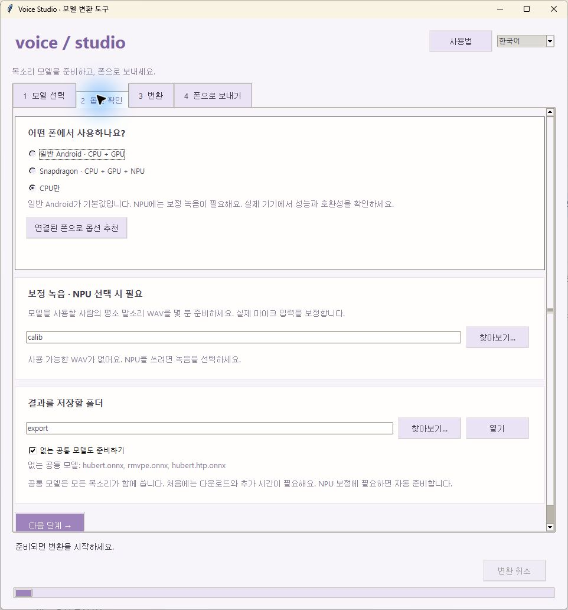
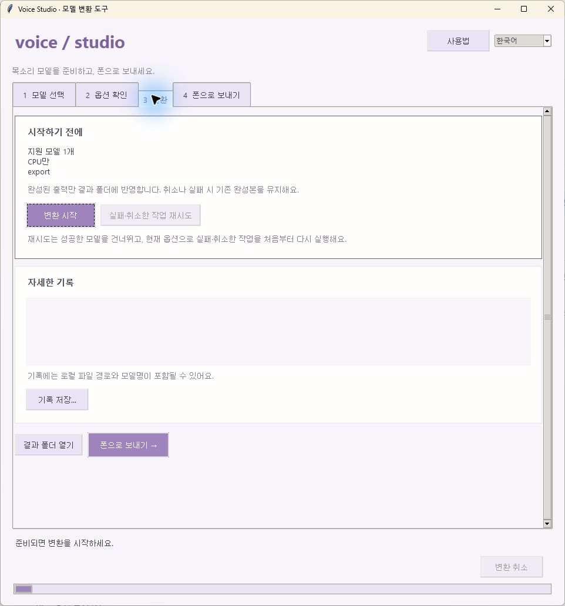

# 컨버터 단계별 사용법 (Windows)

[English](USAGE.md) · [앱 사용법](../docs/USAGE.ko.md) · [내보내기 상세](README.md)

`rvc2phone`은 RVC 목소리 모델 `.pth`를 Voice Studio 폰 앱용 모델 파일로 바꿉니다. 녹음 파일의 목소리를 바꾸는 작업은 모델을 넣은 뒤 폰 앱에서 합니다. 모델 변환과 파일 전송에는 Shizuku가 필요하지 않습니다.

오른쪽 위에서 **한국어 / English**를 바꿀 수 있습니다. 언어·출력 폴더·보정 폴더·기기 옵션은 이 PC에 저장됩니다.

## 화면으로 보는 4단계

실제 Windows 창을 캡처했습니다. `ConverterSmoke`는 문서용 예시 이름이며 폴더는 일반적인 상대 경로로 표시했습니다. 개인 모델명·음높이·로그·기기 식별자는 포함하지 않았습니다. 전송 화면은 폰 연결 전 상태입니다. 이미지를 누르면 원본 크기로 볼 수 있습니다.

<table>
  <tr><th>1. 모델 선택</th><th>2. 옵션 확인</th></tr>
  <tr><td><a href="../docs/screenshots/converter-models-ko.jpg"></a></td><td><a href="../docs/screenshots/converter-prepare-ko.jpg"></a></td></tr>
  <tr><th>3. 변환·재시도</th><th>4. 완성본 전송</th></tr>
  <tr><td><a href="../docs/screenshots/converter-convert-ko.jpg"></a></td><td><a href="../docs/screenshots/converter-send-ko.jpg"></a></td></tr>
</table>

창이 작아 아래 버튼이 보이지 않으면 각 탭 안에서 스크롤하세요. 오른쪽 위 언어 선택으로 같은 기능을 한국어·영어로 사용할 수 있습니다.

## 1. 준비물

- Python 3.10 이상을 설치하고 Python 실행기 또는 PATH를 사용할 수 있게 합니다. `requirements.txt`에 고정된 패키지가 지원하는 버전을 사용하세요. 이 도구의 작업 환경은 Python 3.10입니다.
- 프로젝트 압축을 쓰기 가능한 폴더에 풉니다. 설치 파일·공통 가중치·결과·임시 파일을 위해 수 GB 이상 여유 공간을 두세요. 최초 설치와 공통 모델 다운로드에는 인터넷이 필요합니다.
- **RVC v2 · 32/48 kHz · 음높이(f0) 있음**으로 내보낸 `.pth`를 준비합니다. v1, 40 kHz, f0 없는 모델은 지원하지 않습니다. 32 kHz는 Android 앱 0.4.1 이상이 필요하며 iOS는 아직 48 kHz만 지원합니다. `G_1234.pth` 같은 큰 학습 체크포인트 대신 추론용 모델을 사용하세요.
- Snapdragon NPU 정수 디코더를 만들려면 실제 입력할 사람의 평소 말소리를 WAV로 몇 분 준비해 `converter/calib/`에 넣습니다. 이는 목표 목소리 모델이 아니라 보정용 원본 녹음입니다. 크고 작은 목소리·숨소리 등 다양한 입력을 섞으세요. GUI는 NPU 변환 전에 사용 가능한 녹음을 요구합니다. 명령줄은 녹음이 없으면 정수 디코더만 건너뜁니다.

## 2. 실행

`converter/`의 **`rvc2phone_gui.bat`**을 두 번 누릅니다. `.pth` 파일 여러 개를 이 파일에 끌어다 놓아도 됩니다. 최초 실행은 `setup.bat`이 전용 `.venv`와 패키지를 설치하므로 완료될 때까지 기다리세요. 다음 실행부터는 같은 환경을 재사용합니다.

Python을 못 찾으면 설치 후 실행기를 다시 여세요. 패키지 설치 실패는 터미널 오류·인터넷·Python 지원 버전을 확인한 뒤 재시도합니다. 내보내기 환경 자체에는 CUDA 설치가 필요하지 않습니다.

## 3. 모델 선택과 옵션 확인

1. **1 모델 선택 → 모델 추가**로 `.pth`를 넣습니다. 여러 모델을 검사하며 버전·샘플레이트·음높이 지원 여부를 표시합니다. 지원하지 않는 모델은 변환에서 제외합니다.
2. 모델을 선택하고 **앱에서 쓸 이름**을 정합니다. 문자·숫자·밑줄·하이픈으로 80자 이내로 쓰세요. 대소문자만 다른 중복 이름과 `common`, `CON` 같은 예약 이름은 사용할 수 없습니다.
3. **2 옵션 확인**에서 사용할 폰에 맞는 옵션을 고릅니다.

| 옵션 | 결과 |
| --- | --- |
| 일반 Android · CPU + GPU (기본값) | 일반 ONNX와 Vulkan GPU 디코더 |
| Snapdragon · CPU + GPU + NPU | 보정한 정수 NPU 디코더도 생성, WAV 녹음 필요 |
| CPU만 | 선택 GPU/NPU 디코더 없이 일반 ONNX 생성 |

**연결된 폰으로 옵션 추천**은 선택한 폰의 칩셋으로 옵션을 고릅니다. 실제 성능·호환성은 폰에서 확인해야 합니다. 현재 가상 마이크의 검증 설정은 Snapdragon NPU입니다.

4. NPU를 쓰면 보정 폴더를 골라 사용 가능한 WAV 개수·길이·읽기 실패 수를 확인합니다. 폴더 바로 안에 있는 WAV만 셉니다.
5. 출력 폴더를 고릅니다. **없는 공통 모델도 준비하기**는 공통 모델을 별도 작업으로 준비하며, 3개가 모두 있으면 재사용합니다. NPU 보정에 필요하면 체크를 꺼도 없는 공통 모델을 자동 준비합니다. 최초 다운로드에는 시간이 더 걸립니다.

## 4. 변환과 결과 확인

**3 변환**에서 옵션을 검토하고 **변환 시작**을 누릅니다. 아래에 현재 작업·단계·경과 시간이 표시됩니다. 움직이는 막대는 작업 중이라는 뜻이며 예상 완료율은 아닙니다. 내보내기 상세 출력은 **자세한 기록**에서 확인합니다.

- **변환 취소**는 현재 작업을 중지하고 임시 출력을 정리합니다. 앞서 성공한 모델은 유지합니다.
- **실패·취소한 작업 재시도**는 성공한 모델을 건너뛰고, 현재 옵션으로 미완료 작업을 처음부터 실행합니다.
- 새 파일과 ZIP을 검증한 뒤에만 기존 결과를 교체합니다. 기존 이름을 교체할 때 확인 창이 나옵니다. 실패·취소 시 기존 완성본은 유지합니다.
- **기록 저장…**은 최근 1,500줄을 저장합니다. 공유하기 전 로컬 경로·모델명을 확인하세요.
- **결과 폴더 열기**로 완성본을 확인합니다. GUI 임시 작업은 출력 폴더의 `.jobs` 안에서 진행합니다.

이름이 `MyVoice`라면 결과는 다음과 같습니다.

```text
out/
  MyVoice.zip
  MyVoice/
    MyVoice.enc.onnx
    MyVoice.dec.onnx
    model.json                # 모델 고유 샘플레이트; 꼭 함께 가져오기
    settings.json
    MyVoice.dec.w8a16.onnx      # NPU 옵션 결과
    MyVoice.dec.ncnn.param     # GPU 옵션 결과
    MyVoice.dec.ncnn.bin       # GPU 옵션 결과
  common/
    hubert.onnx
    rmvpe.onnx
    hubert.htp.onnx            # --common으로 생성
```

다른 내보내기 파일이 함께 생길 수도 있습니다. 목소리 폴더는 통째로 유지하세요. 공통 모델은 목소리 ZIP과 별도이므로 ZIP이 있어도 공통 모델이 폰에 준비됐다는 뜻은 아닙니다.

## 5A. USB로 폰에 보내기

1. 폰에 Voice Studio를 설치해 한 번 열고 녹음·변환을 종료합니다. 전송 마지막에 앱을 다시 시작합니다.
2. 개발자 옵션의 USB 디버깅을 켜고 데이터 전송이 되는 케이블을 연결합니다. 폰에 뜨는 이 PC의 디버깅 허용 창을 승인합니다.
3. 컨버터는 Android SDK의 `platform-tools`, `converter/platform-tools/adb.exe`, PATH 순으로 ADB를 찾습니다. 없으면 Google [SDK Platform Tools](https://developer.android.com/tools/releases/platform-tools)를 설치하세요.
4. **4 폰으로 보내기**에서 기기 목록을 새로고침하고 원하는 폰을 고릅니다. `unauthorized`는 폰에서 승인하고, `offline`은 다시 연결하세요.
5. **완성본 선택**에서 보낼 결과를 고릅니다. Ctrl/Shift로 여러 개를 고를 수 있습니다. 이전 실행에서 만든 결과도 출력 폴더에서 검증해 표시합니다. 공통 파일도 필요하면 전송 옵션을 켭니다.
6. **선택한 모델 보내기**를 누릅니다. 출력 폴더가 해당 변환 결과의 위치인지 확인하세요.
7. 완료 메시지와 앱 재시작을 기다립니다. 앱이 파일을 모델 폴더로 정리하므로 별도 불러오기는 필요 없습니다. 폰에서 목소리를 선택하세요.

직접 선택한 완성본만 보냅니다. 모델을 고르지 않고 공통 모델 전송만 체크하면 공통 모델만 보낼 수 있습니다. 이 전송 방식은 폰에 이미 있는 목소리 설정을 유지하고 같은 이름의 모델 파일은 교체합니다. 이미 있는 공통 파일은 건너뜁니다. 파일이 정리되지 않았다면 앱을 다시 열고 전송 기록을 확인하세요.

## 5B. 무선 디버깅으로 보내기

1. PC와 폰이 서로 연결 가능한 네트워크에 있는지 확인하고 폰의 **개발자 옵션 → 무선 디버깅**을 켭니다.
2. 컨버터에서 **무선 연결…**을 누릅니다.
3. 폰의 **페어링 코드로 기기 페어링**을 엽니다. 거기 나온 **IP:페어링 포트**와 6자리 코드를 각각 **페어링 주소**, **페어링 코드**에 넣고 **페어링**을 누릅니다.
4. 폰의 무선 디버깅 기본 화면으로 돌아갑니다. 그 화면의 **IP 주소 및 포트**를 **연결 주소**에 넣고 **연결**을 누릅니다. 페어링 포트와 연결 포트는 보통 다릅니다.
5. 연결된 폰을 선택하고 위 USB 설명의 5–7번처럼 전송합니다. 나중에 다시 연결할 때 주소·포트가 바뀔 수 있습니다.

이는 파일 전송을 위해 PC의 ADB를 연결하는 절차입니다. Shizuku 시작·승인과는 별개이며, 가상 마이크를 쓸 때만 Shizuku를 따로 설정합니다.

## 5C. 디버깅 없이 직접 불러오기

`out/MyVoice.zip` 또는 `out/MyVoice/` 폴더 전체를 폰의 파일 선택기로 접근 가능한 위치에 복사합니다. Voice Studio의 **불러오기 → zip 파일 고르기 / 폴더 고르기**로 선택하세요. 공통 모델은 설정에서 받거나 `out/common/` 폴더를 따로 불러옵니다. 목소리를 선택한 뒤 짧은 파일 변환부터 확인하세요.

수동 불러오기는 `settings.json`을 포함해 기존 파일을 교체할 수 있으므로 설정을 보존하려면 새 모델 이름을 사용하세요. 기존 설정을 보존하는 컨버터 ADB 전송과 동작이 다릅니다.

## 명령줄 사용

`converter/`에서 PowerShell을 열고 공백이 있는 경로는 따옴표로 감쌉니다.

```powershell
# 공통 모델 최초 한 번
.\rvc2phone.bat --common

# 목소리 변환 + 보정, GPU/NPU 옵션 기본 사용
.\rvc2phone.bat "D:\Models\MyVoice.pth" --name MyVoice --calib "D:\Recordings\Calibration"

# 일반 ONNX만 생성
.\rvc2phone.bat "D:\Models\MyVoice.pth" --name MyVoice --no-ncnn --no-npu

# 출력 위치 변경 + 공통 모델도 생성
.\rvc2phone.bat "D:\Models\MyVoice.pth" --name MyVoice --out "D:\PhoneModels" --common
```

환경이 준비돼 있으면 `.\.venv\Scripts\python.exe .\rvc2phone.py --help`로 모든 옵션을 볼 수 있습니다. BAT는 끝에서 키 입력을 기다리므로 자동화에는 Python 스크립트를 직접 호출하세요. `.pth`를 `rvc2phone.bat`에 끌어 놓으면 GUI 없이 기본 옵션으로 변환합니다.

## 문제 해결

| 증상 | 확인할 항목 |
| --- | --- |
| 모델을 거부함 | RVC v2·32/48 kHz·f0 추론용 내보내기인지 확인 |
| 정수 디코더가 없음 | NPU 옵션, 사용 가능한 보정 WAV, 보정 완료 로그 |
| GPU 파일이 없음 | GPU 옵션과 pnnx 내보내기 완료 여부 |
| 폰이 안 보임 | ADB 설치, USB 데이터 케이블·허용 창, 무선 연결 포트 |
| 모델 필요가 계속 뜸 | 공통 모델과 목소리 인코더·디코더 모두 준비됐는지 확인 |
| 보낼 완성본이 안 보임 | 출력 폴더 확인 후 변환·재시도; 미완성 모델은 목록에서 제외 |
| 전송이 중단됨 | 연결 후 재시도; 폰 앱이 중지된 상태일 수 있음. 덜 전송된 파일은 모델 이름으로 반영하지 않음 |
| 소리가 거침 | 계산 장치와 보정 녹음 확인; NPU 16비트 부동소수 디코더와 보정한 정수 디코더는 다름 |

개인 모델·보정 녹음은 저장소에 포함하지 않습니다. 사용 가능한 모델과 음성을 준비하세요. 내보내기 내부 동작과 원본 라이선스는 [README.md](README.md)에 있습니다.
