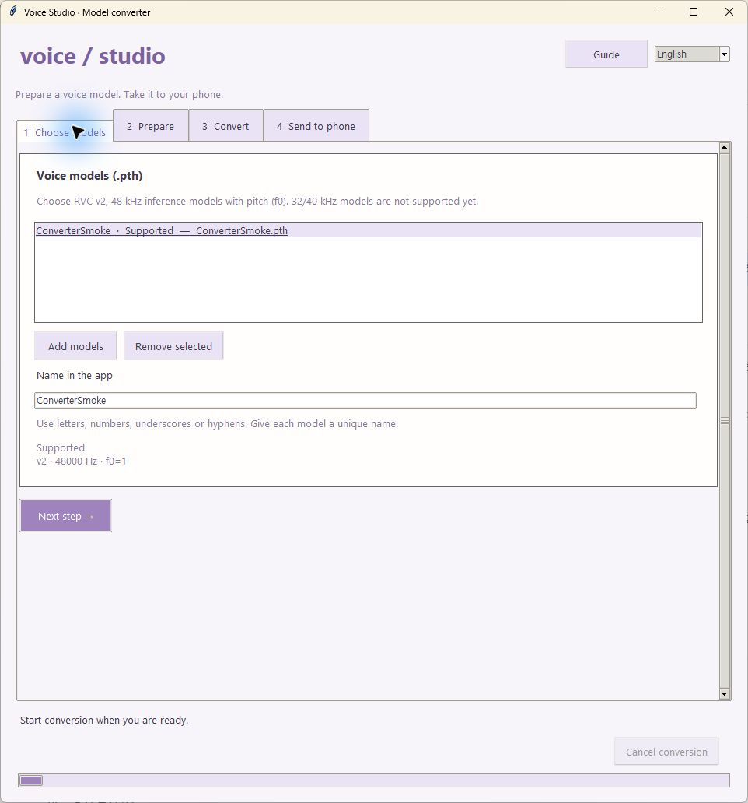
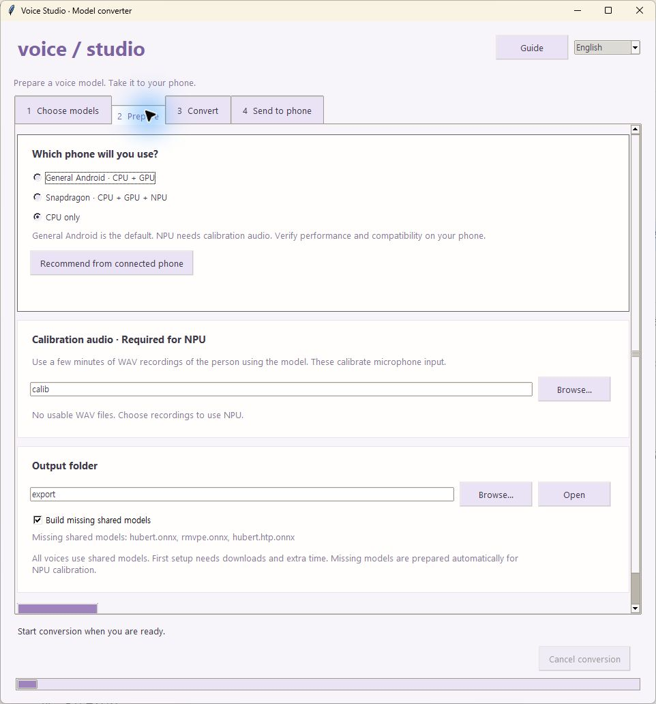
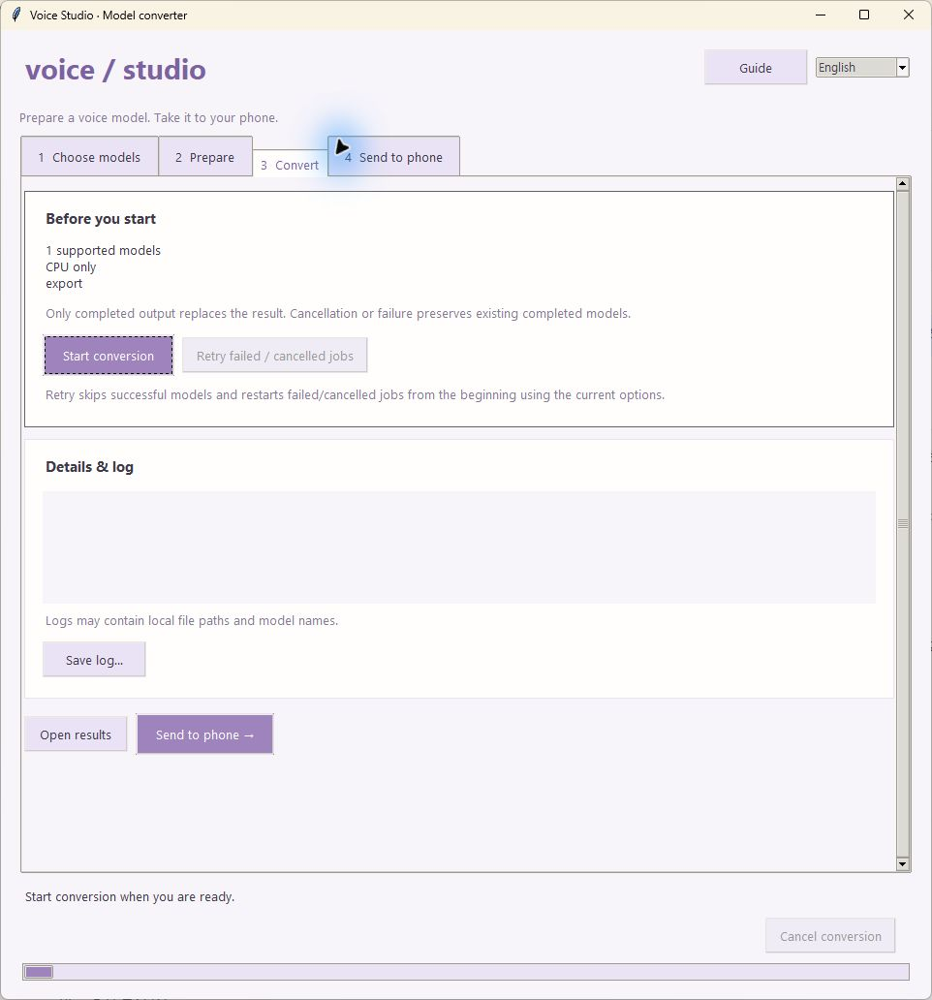
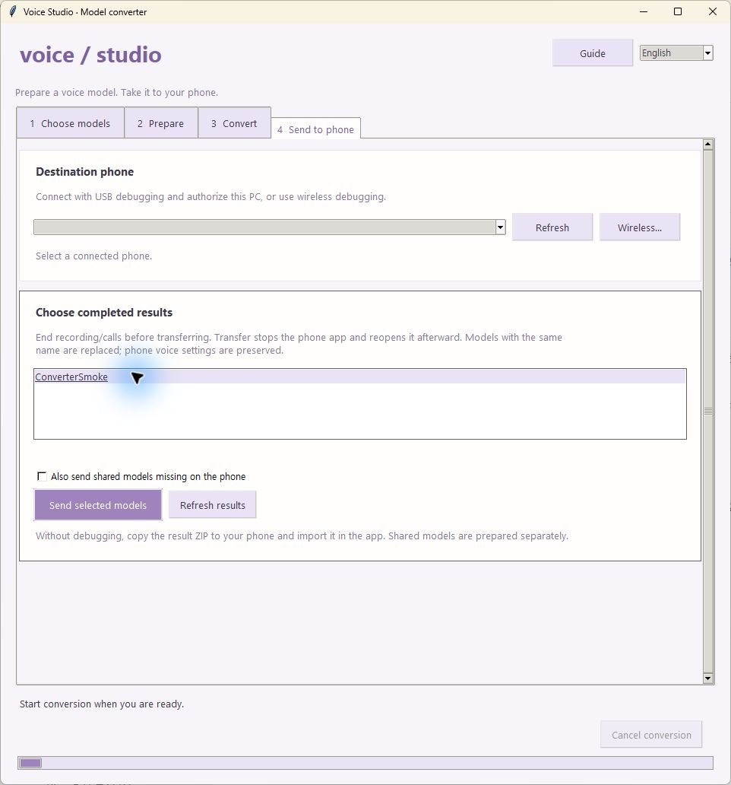

# Converter walkthrough (Windows)

[한국어](USAGE.ko.md) · [App usage](../docs/USAGE.md) · [Export details](README.md)

`rvc2phone` turns an RVC voice `.pth` into model files for Voice Studio. It does not convert a recording into another voice; the phone app does that after importing the model. Shizuku is not needed to convert models or transfer files.

Choose **English** or **한국어** in the upper-right corner. The converter remembers your language, output folder, calibration folder and device preset on this PC.

## The four steps at a glance

Captured from the Windows UI. `ConverterSmoke` is an example name and folders use generic relative paths. No personal model names, pitch settings, logs or device identifiers are shown. The transfer screen is shown before connecting a phone. Click an image for full size.

<table>
  <tr><th>1. Choose models</th><th>2. Prepare</th></tr>
  <tr><td><a href="../docs/screenshots/converter-models-en.jpg"></a></td><td><a href="../docs/screenshots/converter-prepare-en.jpg"></a></td></tr>
  <tr><th>3. Convert and retry</th><th>4. Send completed results</th></tr>
  <tr><td><a href="../docs/screenshots/converter-convert-en.jpg"></a></td><td><a href="../docs/screenshots/converter-send-en.jpg"></a></td></tr>
</table>

Scroll within each tab if a smaller window hides its lower controls. Use the upper-right language selector for the same workflow in English or Korean.

## 1. Prepare the files

- Install Python 3.10 or later with the Python launcher or Python on PATH. Use a Python version supported by the pinned packages in `requirements.txt`; the working environment used for these tools is Python 3.10.
- Extract the project to a writable folder. Leave several GB free for dependencies, downloaded weights, model output and temporary files. The first setup and shared-model download require internet access.
- Prepare an exported **RVC v2, 32/48 kHz, f0-enabled** voice `.pth`. v1, 40 kHz and non-f0 models are not supported. 32 kHz requires Android app 0.4.1 or later; iOS remains 48 kHz only. Use the inference model, not a large training checkpoint such as `G_1234.pth`.
- For the Snapdragon integer NPU decoder, put a few minutes of the intended speaker's normal voice in WAV files in `converter/calib/`. This is calibration input, not the target voice model. Include different levels and ordinary speech sounds. The GUI asks for usable recordings before starting an NPU conversion; the command-line tool skips the integer decoder when recordings are absent.

## 2. Open the converter

Double-click **`rvc2phone_gui.bat`** inside `converter/`. You can also drop one or more `.pth` files onto it. The launcher runs `setup.bat` to create its own `.venv` and install packages. Keep the setup window open until it finishes. Subsequent launches reuse that environment.

If Python cannot be found, install it and reopen the launcher. If package installation fails, read the terminal error, check the connection and supported Python version, then retry. No CUDA installation is required by this CPU-based export environment.

## 3. Choose models and prepare

1. In **1 Choose models**, click **Add models**. Inspection runs in the background and shows version, sample rate and f0 support. Unsupported models are excluded.
2. Select a model and set **Name in the app**. Use letters, numbers, underscores or hyphens, up to 80 characters. Names must be unique, ignoring case; reserved names such as `common` or `CON` are rejected.
3. Open **2 Prepare** and choose a preset:

| Preset | Output |
| --- | --- |
| General Android · CPU + GPU (default) | Ordinary ONNX plus Vulkan GPU decoder |
| Snapdragon · CPU + GPU + NPU | Also builds the calibrated integer NPU decoder; requires WAV recordings |
| CPU only | Ordinary ONNX without optional GPU/NPU decoders |

**Recommend from connected phone** uses the selected phone's chipset to choose a preset. This is a starting point; performance and compatibility still need checking on the phone. The current tested virtual-mic configuration uses Snapdragon NPU.

4. For NPU, choose the calibration folder and check the usable WAV count, duration and unreadable-file count. Only WAVs directly inside that folder are counted.
5. Choose the output folder. **Build missing shared models** prepares shared models separately; a complete set of all three files is reused. NPU calibration automatically prepares them when missing, even if the checkbox is off. Initial downloads can take extra time.

## 4. Convert and inspect the output

Open **3 Convert**, review the names/options and click **Start conversion**. The footer shows the current job, stage and elapsed time. The moving bar indicates activity, not an estimated percentage. Detailed exporter output is available under **Details & log**.

- **Cancel conversion** stops the current process and cleans its temporary output. Completed models from earlier jobs are kept.
- **Retry failed / cancelled jobs** skips successful models and restarts failed or unfinished jobs from the beginning using the current options.
- Existing output is replaced only after the new files and ZIP pass validation. Replacing named outputs requires confirmation. Failed or cancelled work leaves the previous completed output intact.
- **Save log…** saves the most recent 1,500 lines. Review local paths/model names before sharing the log.
- **Open results** opens the chosen output folder. GUI temporary work lives under its `.jobs` directory.

For a voice named `MyVoice`, expect:

```text
out/
  MyVoice.zip
  MyVoice/
    MyVoice.enc.onnx
    MyVoice.dec.onnx
    model.json                # native sample rate; keep with the model
    settings.json
    MyVoice.dec.w8a16.onnx      # optional NPU output
    MyVoice.dec.ncnn.param     # optional GPU output
    MyVoice.dec.ncnn.bin       # optional GPU output
  common/
    hubert.onnx
    rmvpe.onnx
    hubert.htp.onnx            # created with --common
```

Other export parts may be present; keep each voice's folder together. Shared models are separate from the voice ZIP. A ZIP existing does not mean common models are already on the phone.

## 5A. Send by USB (Android)

1. Install Voice Studio on the phone, open it once, and stop any recording or conversion. Transfer restarts the app at the end.
2. Enable USB debugging in Developer options, connect a data-capable USB cable, and allow this PC's debugging prompt on the phone.
3. The converter finds `adb` in the Android SDK's `platform-tools`, its own `converter/platform-tools/adb.exe`, or PATH. Install Google's [SDK Platform Tools](https://developer.android.com/tools/releases/platform-tools) if needed.
4. Refresh the device list in **4 Send to phone** and select the intended phone. `unauthorized` devices need confirmation on the phone; `offline` devices need reconnection.
5. Select one or more voices under **Choose completed results** (Ctrl/Shift for multiple). This lists validated results in the output folder, including previous sessions. Enable shared-model transfer if needed.
6. Click **Send selected models**. The output folder must still point to the folder containing that conversion.
7. Wait for the success message and app restart. Voice Studio sorts the transferred files into its model directories. Select the voice in the app; manual Import is not needed.

Only explicitly selected results are sent. With no result selected, you can send shared models alone by enabling their checkbox. Existing voice settings are preserved by this transfer path; model parts with the same name are replaced. Existing common files are skipped. If files remain loose, open Voice Studio again and check the converter log.

## 5B. Send by wireless debugging

1. Put PC and phone on a network that allows them to communicate. Enable **Developer options → Wireless debugging** on the phone.
2. Click **Wireless…** in the converter.
3. On the phone, open **Pair device with pairing code**. Enter its **IP:pairing-port** into **Pairing address** and the six-digit code into **Six-digit pairing code**, then click **Pair**.
4. Return to the main Wireless debugging screen. Enter its **IP address and port** into **Connection address**, then click **Connect**. The connection port is often different from the pairing port.
5. Select the connected device and follow USB steps 5–7 above. A later session may need a new connection address.

This pairs the PC's ADB for file transfer. It does not start or authorize Shizuku. Set up Shizuku separately only if you want virtual mic.

## 5C. Import manually without debugging

Copy `out/MyVoice.zip` or the whole `out/MyVoice/` folder to a location accessible through the phone's file picker. Open Voice Studio → **Import → Choose ZIP file / Choose folder** and select it. Download shared models in Settings, or import the `out/common/` folder separately. Choose the imported voice and try a short file conversion first.

Use a new model name when preserving a manually imported voice's settings matters: manual Import can replace files including `settings.json`. This differs from the converter's ADB transfer, which preserves existing settings.

## Command-line examples

Open PowerShell in `converter/`. Keep paths containing spaces in quotes.

```powershell
# Build shared models once.
.\rvc2phone.bat --common

# Export a voice, with calibration and both optional backends enabled.
.\rvc2phone.bat "D:\Models\MyVoice.pth" --name MyVoice --calib "D:\Recordings\Calibration"

# Export ordinary ONNX only, without GPU generation or NPU calibration.
.\rvc2phone.bat "D:\Models\MyVoice.pth" --name MyVoice --no-ncnn --no-npu

# Choose another output location and also build common models.
.\rvc2phone.bat "D:\Models\MyVoice.pth" --name MyVoice --out "D:\PhoneModels" --common
```

For an existing environment, `.\.venv\Scripts\python.exe .\rvc2phone.py --help` lists all flags. The batch launcher pauses before exiting; calling the Python script is more convenient for automation. Dropping `.pth` on `rvc2phone.bat` uses defaults without opening the GUI.

## Troubleshooting

| Symptom | Check |
| --- | --- |
| Model rejected | Exported RVC v2, 32/48 kHz, f0 model rather than a training checkpoint |
| No integer decoder | NPU option enabled; usable calibration WAVs; calibration completed in the log |
| No GPU files | GPU option enabled; pnnx export completed |
| Phone not listed | ADB installed; USB data cable/debugging approval or correct wireless connection port |
| Voice imported but app says models needed | Both shared models and the voice encoder/decoder are installed |
| No result available to send | Check the output folder and finish/retry conversion; incomplete models are excluded |
| Transfer interrupted | Reconnect and retry; the phone app may remain stopped. Partial uploads are not published under a model filename |
| Conversion sounds noisy | Try a different compute backend and calibration data; 16-bit float NPU decoding differs from the calibrated integer decoder |

Model weights and personal calibration recordings are not included in the repository. Keep their applicable usage rights and licenses in mind. Export internals and upstream licenses are listed in [README.md](README.md).
